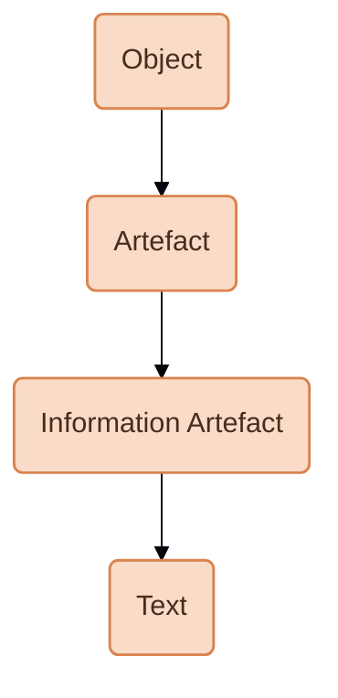

# Loze artefacts, information, and instructions — class taxonomy

Subclasshood relationships between the classes defined in `artefacts-information-and-instructions.ttl`, rooted at `Object` (from `loze-foundation.ttl`) as the super-class of `Artefact`.

- `Object` (top-level class) is the super-class of `Artefact`.
- `Artefact` is the super-class of `Information Artefact`.
- `Information Artefact` is the super-class of `Text`.

