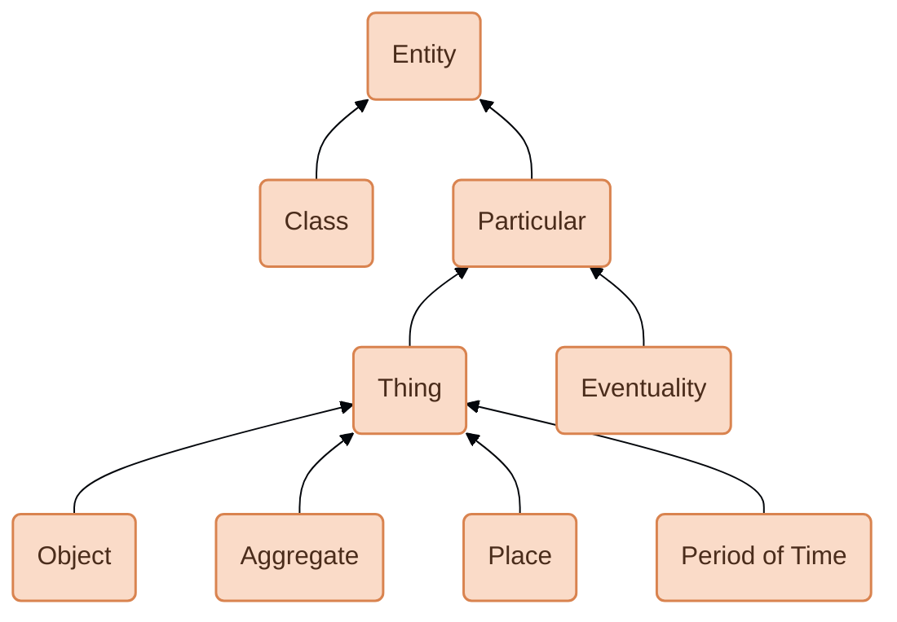

# Loze top-level taxonomy

Subclasshood relationships between Loze's top-level classes, based on `loze-foundation.ttl`.

- `Entity` is partitioned into `Class` and `Particular`.
- `Particular` is partitioned into `Thing` and `Eventuality`.
- `Thing` is partitioned into `Object`, `Aggregate`, `Place`, and `Period of Time`.

