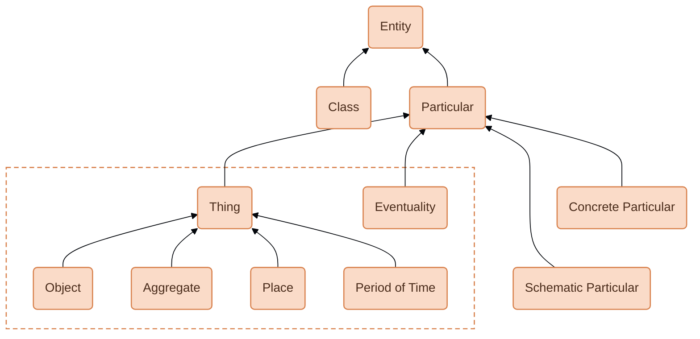

# Loze top-level taxonomy (schematic/concrete facet, uncaptioned box + flanking nodes)

Combines the two previous alternatives: the `Thing`/`Eventuality` subtree sits inside a dashed, uncaptioned box (as in `loze-top-taxonomy-3`), and `Schematic Particular` / `Concrete Particular` are drawn to its right (as in `loze-top-taxonomy-2`) — but positioned to line up with the two rows inside the box, so their vertical span visually echoes the box's height and hints that the schematic/concrete split runs across every class inside it, based on `loze-foundation.ttl`.

- `Entity` is partitioned into `Class` and `Particular`.
- `Particular` is partitioned into `Thing` and `Eventuality`.
- `Thing` is partitioned into `Object`, `Aggregate`, `Place`, and `Period of Time`.
- `Particular` is **also** partitioned into `Schematic Particular` and `Concrete Particular`, styled the same as every other node (solid border, solid edges) — `Schematic Particular` is aligned with the `Thing`/`Eventuality` row and `Concrete Particular` with the `Object`/`Aggregate`/`Place`/`Period of Time` row, so together they span the same height as the dashed box. Their edges from `Particular` enter them on their right-hand side (the side facing away from `Particular`), rather than from the top.
- A short dashed, arrowless line connects the box's right edge to each of `Schematic Particular` and `Concrete Particular`, at the height of the row it lines up with — a purely visual hint (not a subclass relationship) that the schematic/concrete split cuts across every class inside the box.

Every arrow points from a class to its super-class (subclass → superclass), not the other way around. To flip the arrowheads without moving anything, the diagram direction was switched from `TD` to `BT` and every edge's source/target were swapped to match (e.g. `Entity --> Class` became `Class --> Entity`) — under `BT`, that reproduces pixel-identical node positions to the original `TD` version, just with the arrow reversed.

Mermaid's automatic layout does not offer a way to force two sibling nodes at different ranks onto the same vertical line, to pull them in closer to a subgraph than its own layout margins allow, or to choose which side of a node an edge attaches to, so `Schematic Particular` and `Concrete Particular` render farther apart, farther from the box, and with top-entry edges in the Mermaid source below (the two dashed box-to-node hint lines aren't in the Mermaid source at all). The published [loze-top-taxonomy-2.svg](../diagram-images/loze-top-taxonomy-2.svg) is post-processed to align both nodes on the same vertical line closer to the box's right edge, to re-route both subclass edges so they leave each node's right side, bow around it, and enter `Particular`'s right-hand boundary, and to draw the two dashed hint lines directly from the box to each node.

