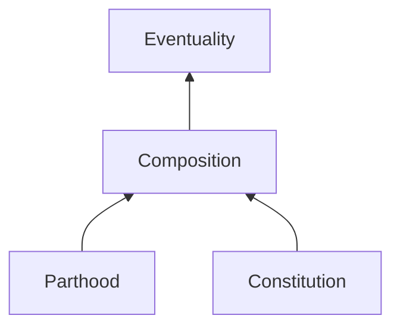

# Loze composition eventualities — class taxonomy

Subclasshood relationships between `Eventuality`, `Composition`, `Parthood`, and `Constitution`, based on `loze-foundation.ttl`.

- `Eventuality` is the super-class of `Composition`.
- `Composition` is partitioned into `Parthood` and `Constitution`.

