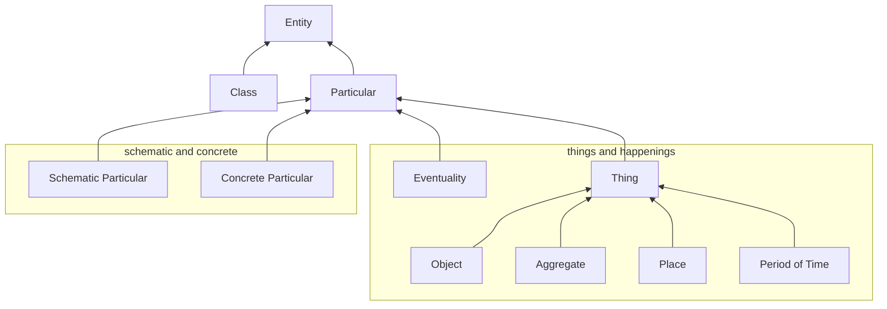

# Loze top-level taxonomy (complete view)

Subclasshood relationships between Loze's top-level classes, based on `loze-foundation.ttl`. Every arrow points from a class to its super-class.

- `Entity` is partitioned into `Class` and `Particular`.
- `Particular` is partitioned into `Thing` and `Eventuality`.
- `Thing` is partitioned into `Object`, `Aggregate`, `Place`, and `Period of Time`.
- `Particular` is **also** partitioned into `Schematic Particular` and `Concrete Particular`.

The two boxes are the two partitions of `Particular`. They are independent cuts, not four sibling classes: every particular falls on one side of each.

