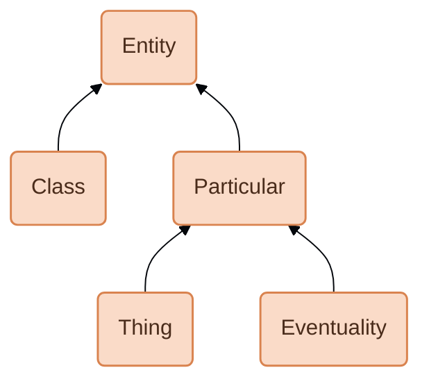

# Loze top-level taxonomy (core classes only)

Subclasshood relationships between Loze's top-level classes `Entity`, `Class`, `Particular`, `Thing`, and `Eventuality`, based on `loze-foundation.ttl`.

- `Entity` is partitioned into `Class` and `Particular`.
- `Particular` is partitioned into `Thing` and `Eventuality`.

