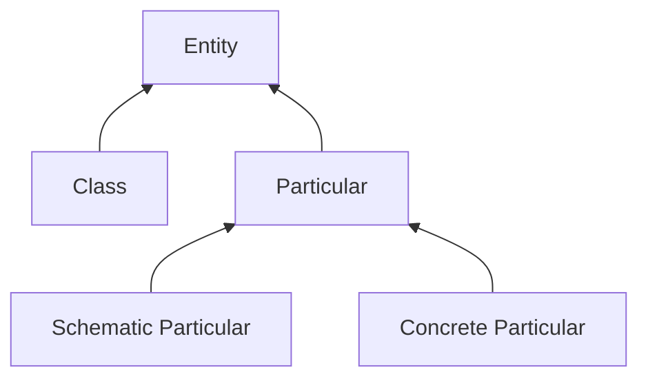

# Loze top-level taxonomy (Entity / Class / Particular / Schematic / Concrete)

Subclasshood relationships between `Entity`, `Class`, `Particular`, `Schematic Particular`, and `Concrete Particular`, based on `loze-foundation.ttl`. Every arrow points from a class to its super-class.

- `Entity` is partitioned into `Class` and `Particular`.
- `Particular` is partitioned into `Schematic Particular` and `Concrete Particular`.

