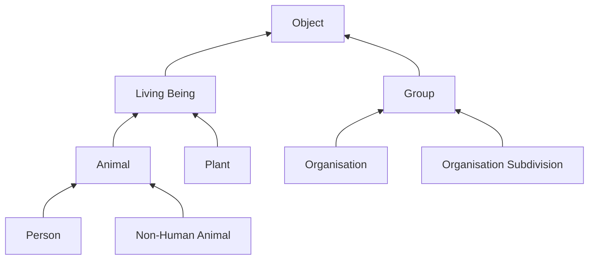

# Loze suggested social extension — class taxonomy

Subclasshood relationships between the classes defined in `suggested-social-extension.ttl`, rooted at `Object` (from `loze-foundation.ttl`) as the super-class of `Living Being` and `Group`.

- `Object` (top-level class) is the super-class of `Living Being` and `Group`.
- `Living Being` is partitioned into `Animal` and `Plant`.
- `Animal` is partitioned into `Person` and `Non-Human Animal`.
- `Group` is the super-class of `Organisation` and `Organisation Subdivision`.

