# Loze

Loze is meant as a simple upper-level ontology, which avoids unnecessary categorial distinctions and offers a gamut of highly flexible, easy to use modelling patterns. It is largely inspired by the Four-Category Ontology outlined by the philosopher Jonathan Lowe (2006, 2009), supplemented with the concept of a schematic particular investigated by Eddy Zemach (1970, 1992). The very name of the ontology consists of references to the two aforementioned philosophers: **Lo**we and **Ze**mach, hence **Loze**. Our ontology combines that top-level framework with an apparatus of thematic relations that draws from decades of research at the interface of philosophy and linguistics (Parsons 1990 & 1995; Orilia 2019).

## Loze's Architecture

Loze is partitioned into one foundational modules and a number of mid-level extensions. The foundational core is hosted in `/loze-foundation.ttl`: it is the most general, top-level part of Loze and is meant to be completely domain-independent. The extensions currently include the following:

1. An ontology of artefacts and information. This includes the general concept of an artefact (`loze:Artefact`), a few subclasses for information artefacts, and relations . 
2. An ontology of materials and composition: this introduces the concept of a substance (`loze:Substance`), which has as superclass the foundational class `loze:SchematicParticular`, as well as a few relations for modelling the material composition of objects and aggregates. 
3. A suggested social extension, which consists of highly general classes pertaining to the social domain, such as `loze:Person`, `loze:Group` and `loze:Organisation`.
4. A set of temporal relations for (i) relating eventualities to periods of time and for (ii) describing the connections between the periods of time themselves. 

The set of extensions is open to additions, so the ones included in this repository should not be viewed as exclusive.

## Loze Foundation

Loze Foundation can be carved itself into - which are highlighted by corresponding comments in the file: (i) a category system consisting of ten top-level classes and two relations, (ii) an apparatus of eighteen domain-independent thematic relations, (iii) five types of eventualities with their two specialised thematic relations, and (iv) two fundamental relations for linking eventualities. (NB the count of the relations does not include their inverses).

### Loze's Category System

. Loze's category system consists of ten class, arranged on four hierarchical levels - that is, between the top-class and the bottom-level classes there are two levels of intermediate classes.

The top-level class of Loze is `loze:Entity`: this is a maximally comprehensive class that is meant to encompass everything that exists, is real, or is in the world. It is equivalent (`owl:equivalentClass`) to the built-in OWL class `owl:Thing`. The direct division of `loze:Entity` is into two direct subclasses, namely `owl:Class` and `loze:Particular`. `owl:Class` is defined in Loze the same way it is defined in the Semantic Web: a class is any entity that is a type or kind of entities, and which can have other entities as instances. The Loze concept of a particular largely correspond to the Semantic Web concept of an individual, but it is not perfectly equivalent: in . By contrast, in Loze a particular is any entity that is *not* a class - that is, any entity that is not a type or kind of entities. Consequently, in Loze `owl:Class` and `loze:Particular` are disjoint, and `loze:Entity` is a disjoint union (`owl:disjouintUnionOf`) of them.

Loze does not introduce any further ontological division under `owl:Class`, so the rest of this documentation will focus on the various subclasses of `loze:Particular` and the relations defined for linking particulars.

The class `loze:Particular` has two direct divisions, based on two different criteria: one is based on inherence and modification, the other on spatial boundaries. The former is the division between those particulars that are modifications or qualifications of other particulars and those that are not: those are called respectively *eventualities* (`loze:Eventuality`) and *things* (`loze:Thing`).

The other direct division of `loze:Particular` is between those particulars that are bounded to one place at a time and those that are not: those are called respectively *concrete particulars * (`loze:ConcreteParticular`) and *schematic particulars* (`loze:SchematicParticular`). .

Schematic particulars can indeed seem very similar to classes: both are repeatable, since both can ; classes are represented by their instances, schematic particulars are represented by their concretisations. We said that a schematic particular is presented wherever one of its concretisations is present; but by the same token why might say that a class is present wherever one of its instances is present. Given these similarities, one might wonder whether there is any substantive difference between classes and schematic particulars, and whether concretisation is just instantiation under a different name. However, there is one major disanalogy between classes and schematic particulars, which in our view justifies including the latter under the class `loze:Particular`: differently from a class, a schematic particular share the essential properties of its concretisations. For example, *War and Peace* has the same chapter division as its copies, and it is also a book; likewise, a workflow has the same division in steps as its implementations. By contrast, classes don't have any of the essential properties of their instances: a class of books is not a book, and a class of actions is not an action. At first glance, this might seem like a nuanced philosophical distinction of little relevance in an applied ontology, but in section we will see how the distinctive nature of schematic particulars can vastly simplify the patterns for formalising general statements.

The division between concrete particulars and schematic particulars cuts across all the other subclasses of `loze:Particular`: there are concrete objects as well as schematic objects, concrete aggregates as well as schematic aggregates, concrete eventualities as well as schematic eventualities, and so on.

### Fourth-level Classes

The class `loze:Thing` is further divided into four subclasses, based on the individual principles of their instances: `loze:Object`, `loze:Aggregate`, `loze:Place`, and `loze:PeriodOfTime`. Objects are those things that are individuated based on their form, internal organisation, or function: . Differently from objects, aggregates are individuated based on their material composition. Needless to say, this does not entail that objects have no material composition, but only that they are not individuated according to it. 

Places are those things that are individuated according to their position relative to other things: for example, . Finally, period of times are those things that are individuated according to their coordinates across the temporal axis - according to their "when", so to say.

One salient feature of Loze is the category of *eventualities*, which correspond to what Lowe calls *modes*. This top-level class encompasses entities that in other ontologies are variously called 'events', 'processes', 'qualities', 'activities', 'relations' etc... . While those are usually considered to be disjoint categories, we believe that the criteria used for distinguishing between them are either superficial or impractical. For example, every event can also be viewed as a relation, because it holds between certain entities considered in a given order. Other ontologies distinguish between happenings that are instantaneous and other - in HQDM, those are called respectively *events* and *activities*. Again, this is also an ephemeral distinction, : as a result, that collapses into the vague distinction between short-lived happenings and long happenings.

Overall, we conclude that what is common among those entities is much more robust than their differences: these are all entities that make some other entities be in a certain way; they are the *way* in which other entities are. In Lowe's Four-Category Ontology, these entities are aptly called *modes*. Unfortunately, the term "mode" would be very confused in an industry setting, because it can easily make one think of the functional mode of a device. As an alternative, we propose the term *eventuality*. Compared to "event", "eventuality" does not have a dynamic connotation, and it does not suggest a brief duration. Differently from "action" and "activity", it is not commonly used for the performances of agents - that is, beings with deliberative capacities. Finally, "eventuality" is loose enough to encompass relations and qualities, for which the term "event" would be forced.

In practical terms, the main rationale for the class `loze:Eventuality` is the construction of a highly versatile reification pattern that can be easily applied across domains and enables temporal modelling: indeed, time can be represented by simply positing an eventuality and assigning a period of time to it. The entities that are modified or qualified by an eventuality are its *participants*. In section , we will walk through the apparatus of thematic relations of Loze, which enable its users to specify the different ways in which entities are involved in an eventuality.

## Thematic Relations

. The relation `loze:isParticipantIn` is the top thematic relation, in the formal sense that any other thematic relation is a sub-relation of it. That being said, in most contexts `loze:isParticipantIn` will be too broad to be informative: therefore, we propose a gamut of more specific sub-relations. These are still domain-independent, and yet are informative enough .

For a one-by-one illustrations of Loze's thematic relations, we redirect to the detailed annotations contained in the file `/loze-foundation.ttl`. Here we are going to offer a quick overview of their scope. For example, `loze:isAgentIn` is the relation for specifying who does things in the context - more formally, for picking the participant that causes changes upon other participants. On the other hand, `loze:isAffectedIn` is meant for specifying the participant that is being acted upon by some other participat. These two are very flexibile yet informative relations that can be applied whenever one entity does something to another one. Similarly, `loze:isInstrumentIn` allows us to specify the means by which an eventuality is performed, and can applied : a kitchen knife is the instrument in a slicing, a debit card is the instrument in a payment, a duct network is the instrument in the supply of water, and so on. Relations like `loze:isRecipientIn` and `loze:isBeneficiaryIn` are meant for specifying . A dedicated set of relations - - . 

## References

Lowe, E. J. (2006). *The Four-Category Ontology*, Oxford: Oxford University Press.

Lowe, E. J. (2009). *More Kinds of Being*, Wiley-Blackwell.

Orilia, F. (2019). "Relations, O-roles and Applied Ontology", *Philosophical Inquiries*, 7 (1), 115-32.

Parsons, T. (1990). *Events in the Semantics of English*, MIT Press.

Parsons, T. (1995). "Thematic Relations and Arguments", *Linguistic Inquiry*, 26 (4): 635-62.

Zemach, E. M. (1970). "Four Ontologies", *The Journal of Philosophy*, 67 (8): 231-47.

Zemach, E. M. (1992). *Types: Essays in Metaphysics*, E. J. Brill Publishers.

